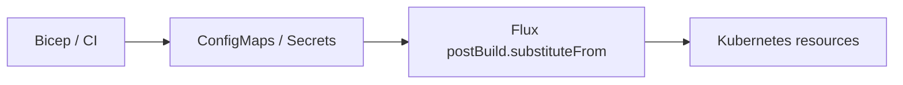

# Bicep → Flux: validate values at the handoff

This example supports slide 8. The team described a workflow in which
Bicep or CI creates ConfigMaps/Secrets and Flux reads their values.
The names, fields and token in this teaching example are synthetic.
No company infrastructure definitions or actual cluster values were read.



Flux resolves `substituteFrom` against objects in the Flux Kustomization's
namespace and substitutes values after Kustomize builds its manifests.
ConfigMap data is string-valued; the consuming field may need an integer,
boolean or a more specific string contract. Bicep's typed outputs do not
automatically carry a CUE contract across that boundary.

## Where validation can run

- **Retain Flux's value resolution:** validate Bicep/CI outputs against a
  consumer contract before publishing them, or check the resolved consumer
  input after substitution. A CUE check of an earlier placeholder does not
  validate the concrete value Flux inserts later.
- **Use Timoni Runtime:** explicitly run a CLI step that reads the cluster
  objects into typed Bundle inputs. The module can then validate and render
  with concrete values. Flux does not invoke Timoni Runtime automatically.
  If an extra render step is introduced, changes to the source values must
  trigger that step again; it is not a continuous watcher by itself.

The runtime files below demonstrate the second mechanism offline. They
are not a replacement deployment or an implementation of either design.

## Try the contract offline

[runtime.cue](runtime.cue) declares a ConfigMap query for `DEMO_REPLICAS`
and a Secret query for `DEMO_TOKEN`. [bundle.cue](bundle.cue) binds runtime
inputs to separate fields, then unifies the consumed values with
`#InfraValues`: an integer from 1 to 10 and a nonempty string.

Slide 8's [CUE excerpt](../krombat.typ) writes those constraints directly
on the consuming `values` fields. `_replicas` and `_token` hold Runtime
inputs; `&` combines each with its consumer contract. The excerpt omits
Bundle metadata, the module reference and namespace. The complete file
above includes them and reuses the named `#InfraValues` contract.

From this directory:

```bash
# Accepted, using only synthetic environment values.
DEMO_REPLICAS=3 DEMO_TOKEN=demo-only \
  timoni bundle vet -f bundle.cue -r runtime.cue \
  --offline --kube-context=minikube

# Expected failure: outside the declared range.
DEMO_REPLICAS=0 DEMO_TOKEN=demo-only \
  timoni bundle vet -f bundle.cue -r runtime.cue \
  --offline --kube-context=minikube

# Expected failure: cannot be injected as a number.
DEMO_REPLICAS=three DEMO_TOKEN=demo-only \
  timoni bundle vet -f bundle.cue -r runtime.cue \
  --offline --kube-context=minikube
```

`--offline` takes runtime values from environment variables instead of
contacting Kubernetes. Missing or empty token inputs are also rejected.
The runtime context is explicitly `minikube`; the shared current context
is never changed. No apply or live runtime-read command is needed here.

The module URL uses `example.invalid` deliberately. `bundle vet` checks
the Bundle and the contract expressed inside it; it does not fetch the
module or validate values against that module's schema. A real module
build is still required to validate the module interface and rendered
resources. Only dummy inputs were used, without printing computed values.

Checked with Timoni 0.35.0 / embedded CUE 0.17.1. No registry, Azure or
Kubernetes API was contacted. The offline input checks establish the
contract behavior, not live lookup or change propagation.

## Delivering kro expressions through Flux

Flux substitution and kro CEL both use `${…}` syntax. For an RGD that
needs no Flux substitutions, the annotation
`kustomize.toolkit.fluxcd.io/substitute: disabled` preserves the whole
object. For an object that mixes Flux inputs and CEL, escape the CEL
placeholder for the Flux pass, for example `$${schema.spec.replicas}`,
so the final RGD still contains `${schema.spec.replicas}` for kro.
Disabling substitution for the whole object also disables any intended
Bicep-derived substitutions in it. This handling belongs in the delivery
step; the existing offline RGD example emits ordinary, unescaped CEL.

Sources: [Bicep outputs](https://learn.microsoft.com/en-us/azure/azure-resource-manager/bicep/outputs),
[Flux substitution](https://fluxcd.io/flux/components/kustomize/kustomizations/#post-build-variable-substitution),
[ConfigMap data](https://kubernetes.io/docs/concepts/configuration/configmap/),
[Timoni Runtime](https://timoni.sh/bundle-runtime) and
[the Timoni/Flux integration boundary](https://timoni.sh/gitops-flux).
