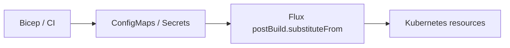

# External values: Flux substitution and Timoni Runtime

This example accompanies slides 8–11. It illustrates a Bicep/CI →
ConfigMaps/Secrets → Flux delivery pattern and a separate Timoni Runtime
path for binding external values to a CUE consumer contract. Object names,
fields and tokens are synthetic.



Flux's [post-build substitution](https://fluxcd.io/flux/components/kustomize/kustomizations/#post-build-variable-substitution)
resolves `substituteFrom` against objects in the Flux Kustomization's
namespace and substitutes values after Kustomize builds its manifests.
ConfigMap data is string-valued; the consuming field may need an integer,
boolean or a more specific string contract. Bicep's typed outputs do not
automatically carry a CUE contract across that boundary.

## Where validation can run

- **Flux substitution:** validate Bicep/CI outputs against a
  consumer contract before publishing them, or check the resolved consumer
  input after substitution. A CUE check of an earlier placeholder does not
  validate the concrete value Flux inserts later.
- **Timoni Runtime:** explicitly run a CLI step that reads the cluster
  objects into typed Bundle inputs. The module can then validate and render
  with concrete values. Flux does not invoke Timoni Runtime automatically.
  If an extra render step is introduced, changes to the source values must
  trigger that step again; it is not a continuous watcher by itself.

The files below demonstrate Runtime query mappings and input contracts
using offline validation.

## 1. Select resources and map their fields

[Timoni Runtime](https://timoni.sh/bundle-runtime) uses queries to select
Kubernetes resources and `for` mappings to expose named inputs. This
excerpt from [runtime.cue](runtime.cue) selects two fields:

```cue
runtime: values: [{
  query: "k8s:v1:ConfigMap:demo:infra-values"
  for: "DEMO_REPLICAS": "obj.data.replicas"
}, {
  query: "k8s:v1:Secret:demo:infra-secrets"
  for: "DEMO_TOKEN": "obj.data.token"
}]
```

The query identifies the API version, kind, namespace and object name.
Each mapping pairs a Runtime input name with an expression selecting a
field from `obj`. The complete file also declares the Runtime metadata
and explicitly selects the `minikube` context. The slide omits those
fields to focus on the queries.

## 2. Bind the inputs and apply a consumer contract

A [Bundle](https://timoni.sh/bundle) declares module instances and their
values. The excerpt from [bundle.cue](bundle.cue) separates the reusable
contract, Runtime bindings and consumed values:

```cue
#InfraValues: {
  replicas: int & >=1 & <=10
  token:    string & !=""
}
bundle: {
  _replicas: number @timoni(runtime:number:DEMO_REPLICAS)
  _token:    string @timoni(runtime:string:DEMO_TOKEN)
  instances: web: values: #InfraValues & {
    replicas: _replicas
    token:    _token
  }
}
```

The attributes bind named inputs to hidden fields. `runtime:number`
parses a CUE number; `runtime:string` preserves text. The consuming
`values` then unify those inputs with `#InfraValues`: an integer from
1 to 10 and a nonempty string. Keeping the constraints at the consumer
separates parsing from contract validation. The [hidden fields](https://cuelang.org/docs/tour/references/hidden/)
hold intermediate inputs and are not exported as application configuration.

For example, ConfigMap text `"3"` becomes number `3` and satisfies the
contract. A fraction parses as a number but conflicts with `int`; `0`
conflicts with the range; `three` fails number parsing. An empty token
conflicts with the nonempty-string constraint. The complete Bundle also
declares its API version, name, module reference and namespace.

## 3. Check the contract offline

From this directory:

```bash
# Accepted, using only synthetic environment values.
DEMO_REPLICAS=3 DEMO_TOKEN=demo-only \
  timoni bundle vet -f bundle.cue -r runtime.cue \
  --offline --kube-context=minikube

# Expected failure: outside the declared range.
DEMO_REPLICAS=0 DEMO_TOKEN=demo-only \
  timoni bundle vet -f bundle.cue -r runtime.cue \
  --offline --kube-context=minikube

# Expected failure: cannot be injected as a number.
DEMO_REPLICAS=three DEMO_TOKEN=demo-only \
  timoni bundle vet -f bundle.cue -r runtime.cue \
  --offline --kube-context=minikube
```

`--offline` takes runtime values from environment variables instead of
contacting Kubernetes. Missing or empty token inputs are also rejected.
The runtime context is explicitly `minikube`; the shared current context
is never changed. No apply or live runtime-read command is needed here.

The module URL uses `example.invalid` deliberately. `bundle vet` checks
the Bundle and the contract expressed inside it; it does not fetch the
module or validate values against that module's schema. A real module
build is still required to validate the module interface and rendered
resources. Only dummy inputs were used, without printing computed values.

Checked with Timoni 0.35.0 / embedded CUE 0.17.1. No registry, Azure or
Kubernetes API was contacted. The offline input checks establish the
contract behavior, not live lookup or change propagation.

## Execution and reconciliation

Runtime reads values when its CLI step runs. A source-object change needs
another execution to refresh the inputs. A pipeline can resolve inputs,
check the contract and build manifests before delivering them to Flux.
The trigger for that pipeline is a separate configuration decision.

The [Timoni/Flux guide](https://timoni.sh/gitops-flux) describes delivery
of rendered manifests. Flux does not automatically invoke Runtime
injection. These examples establish the lookup definition and offline
contract behavior; they do not implement a continuously triggered
delivery pipeline.

## Delivering kro expressions through Flux

Flux substitution and kro CEL both use `${…}` syntax. For an RGD that
needs no Flux substitutions, the annotation
`kustomize.toolkit.fluxcd.io/substitute: disabled` preserves the whole
object. For an object that mixes Flux inputs and CEL, escape the CEL
placeholder for the Flux pass, for example `$${schema.spec.replicas}`,
so the final RGD still contains `${schema.spec.replicas}` for kro.
Disabling substitution for the whole object also disables any intended
Bicep-derived substitutions in it. This handling belongs in the delivery
step; the existing offline RGD example emits ordinary, unescaped CEL.

Additional references: [Bicep outputs](https://learn.microsoft.com/en-us/azure/azure-resource-manager/bicep/outputs)
and [ConfigMap data](https://kubernetes.io/docs/concepts/configuration/configmap/).
